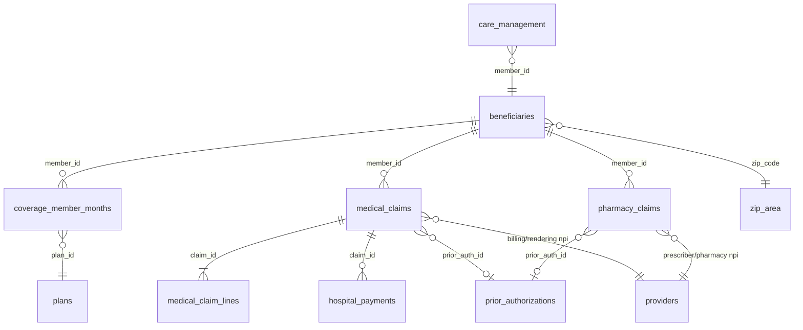

# Synthetic Health Data Warehouse

A reproducible generator for a fully synthetic, relational healthcare data set for teaching graduate-level health data analytics. The data mimic what a health plan and a hospital system would hold for a regional population over five years (2021–2025): member demographics, monthly eligibility, medical and pharmacy claims, prior authorizations, care-management enrollments, and a hospital patient-accounting (payment) ledger.

Everything is synthetic. No real person, claim, provider, or plan is represented.

## The setting

- **Region:** North Central Florida (Alachua, Marion, Columbia, Putnam, Levy, Citrus, Clay and nearby counties). The zip codes and their coordinates are real; every area measure attached to them is synthetic.
- **Population:** 25,000 people by default, observed January 2021 to December 2025. People are born, move in or out, age into Medicare, and die.
- **Payers:** commercial (fully insured, HDHP and self-funded), ACA Marketplace, Medicaid fee-for-service and managed care, Original Medicare with Part D, and Medicare Advantage (including a D-SNP). People churn between payers. Medicaid continuous enrollment through March 2023 is followed by the 2023–24 unwinding.
- **Hospital system:** *Sabal Ridge Health* (fictional) runs two hospitals, an outpatient lab and an employed physician group. Its 835-style payment ledger is the `hospital_payments` table. Competing fictional hospitals and plans fill out the market.
- **Identifiers:** NPIs and NDCs are synthetic and start with `9`, so they can't collide with real ones. Plan, provider and facility names are invented.

## Tables

| Table | Grain | What it's for |
|---|---|---|
| `beneficiaries` | person | Demographics, residence zip, death date |
| `coverage_member_months` | member × month | Payer, plan, product, dual status, Rx coverage, assigned PCP, premium |
| `medical_claims` | claim | 837P/837I headers: dates, setting, DRG, NPIs, up to 10 ICD-10 dx, charges, allowed, paid, cost sharing, status, denial CARC, resubmissions, appeals |
| `medical_claim_lines` | claim line | CPT/HCPCS, CPT II quality codes, modifiers, revenue codes, units, line amounts, line denials |
| `pharmacy_claims` | fill | NDC, days supply, quantity, prescriber, pharmacy, tier, PA, paid and rejected (NCPDP) claims, cost split |
| `hospital_payments` | transaction | Sabal Ridge ledger: charges, payer payments, contractual adjustments, sequestration, denials, appeals, secondary payments, patient payments, self-pay discounts, charity care, bad debt |
| `prior_authorizations` | request | Medical and pharmacy PA requests: channel (ePA, portal, fax, phone), timestamps, decision |
| `care_management` | enrollment | Transitional Care Program (hospital) and Diabetes Complex Case Management (plan) |
| `providers` | NPI | Directory with specialty, taxonomy, practice/TIN, health system, ACO, FQHC flag |
| `zip_area` | zip | Area deprivation, income, poverty, vehicle and broadband access, PCP and pharmacy supply, distance to a hospital |
| `plans` | plan | Benefit design: deductible, coinsurance, copays, OOP max, PA and PCP requirements |
| `ref_*` | code | ICD-10, CPT/HCPCS, revenue codes, MS-DRG, drugs (with MME), CARC, NCPDP rejects, illustrative HCC crosswalk |

The [data dictionary](docs/data_dictionary.md) documents every column. A separate `answer_key` schema (instructor database only) holds the generator's hidden truth for instructors: true conditions, latent traits, fraud ground truth, program effects and zip risk.



## Quick start

```bash
pip install -r requirements.txt
python generate.py                    # 25,000 members, about 10 minutes
python generate.py --members 2000     # small build in under a minute
python generate.py --seed 42 --csv    # different random draw, plus gzipped CSVs
pytest -q                             # data-quality checks on output/
python scripts/make_docs.py           # refresh docs/data_dictionary.md
```

Outputs go to `output/`:

- `health_analytics.duckdb`: the **student database**, with course tables only. This is the file to distribute.
- `health_analytics_instructor.duckdb`: the same tables plus the `answer_key` schema. Keep it private.
- `parquet/main/*.parquet` and `parquet/answer_key/*.parquet`: one file per table.
- `csv/` (with `--csv`).

The same seed always produces the same data.

## Using the data: DuckDB, DBeaver and JupyterLab

The labs run entirely on free, open-source tools. Students open `health_analytics.duckdb` read-only in **DBeaver Community** (SQL editor) and **JupyterLab** (Python, ML, and SQL via JupySQL). Step-by-step student instructions, the conda environment and a starter notebook are in [`../software-setup`](../software-setup).

Every table and column in the DuckDB files has a description attached. It shows in DBeaver, or you can query it with `SELECT * FROM duckdb_columns()`.

The Parquet copies in `output/parquet/` load into any other engine (PostgreSQL, Spark, BigQuery, Snowflake) if you need one later.

Example queries for each lab topic are in [`sql/examples/`](sql/examples/). They're written in DuckDB SQL.

## Lab topics supported

| Lab | Technique | Main tables |
|---|---|---|
| Querying claims data | SQL basics | `medical_claims`, `medical_claim_lines`, `ref_*` |
| Claim denials | CASE WHEN | `medical_claims` (status, CARC), `hospital_payments`, `ref_carc` |
| Tracking electronic prior authorization use | GROUP BY | `prior_authorizations`, `pharmacy_claims` (reject 75), `providers` |
| Patient attribution | Joins | `medical_claims`, `providers` (ACO), `coverage_member_months.assigned_pcp_npi` |
| HEDIS scores | Subqueries | `coverage_member_months` (continuous enrollment), claim lines (83036, CPT II, 77067, 92014), `pharmacy_claims` (statins) |
| Provider performance comparison | Query optimization | HEDIS results by `practice_id`, cost and utilization by provider |
| Closing coding gaps (risk adjustment) | Intro to ML | MA members' dx year over year, `ref_hcc_crosswalk`, Rx evidence of conditions |
| Readmission reduction program impact | Logistic regression | inpatient claims, `care_management` (Transitional Care Program) |
| Root causes of diabetes complications | Random forests | dx history, adherence from `pharmacy_claims`, coverage gaps, `zip_area` |
| Targeting high-risk zip codes | Neural networks | `zip_area`, ED and inpatient use by zip |
| Fraud detection | K-means | provider-level billing profiles from claims and pharmacy |
| Finding a potential intervention | Multi-model workflow | all of the above |

The labs depend on deliberate structure in the data: program effects, selection bias, risk drivers and fraud schemes. These are described in [`docs/instructor_notes.md`](docs/instructor_notes.md) and recorded in the `answer_key` schema.

> **Public repo warning:** the generator code and `docs/instructor_notes.md` show how the lab answers are built in. If students can see this repository, they can read the answers. Keep it private, or remove the instructor notes before making it public.

## Realism notes and limitations

- Dollar amounts, DRG weights, fee schedules and chargemaster markups are plausible approximations for teaching, not official rates. Medicare deductibles, Part B premiums and the sequestration timeline (0% → 1% → 2% in 2022) follow published values.
- HCC categories use CMS-HCC V28 labels, but the crosswalk is a small illustrative subset with illustrative coefficients.
- Clinical patterns (prevalence, utilization, readmissions, adherence) are tuned to look reasonable in aggregate, not to match any specific benchmark.
- Claims adjudicated after 2026-03-31 (the as-of date) show as `Pending`. Ledger rows after that date are excluded, so open A/R exists at the snapshot.

## Repository layout

```
generate.py                 CLI entry point
src/synthhealth/
  reference.py              code sets, plans, drugs, DRGs, CARCs
  world.py                  zip-level area data and provider directory
  population.py             members, latent health traits, chronic conditions, deaths
  coverage.py               monthly eligibility simulation
  encounters.py             clinical event generator (visits, ED, inpatient, programs, fraud)
  engine.py                 claim pricing, adjudication, denials/rework, PA, hospital ledger
  pharmacy.py               medication regimens and pharmacy claims
  build.py                  orchestration and DuckDB/Parquet export
  dictionary.py             table/column descriptions
scripts/make_docs.py        data dictionary from a build
sql/examples/               starter queries by lab topic
tests/                      data-quality checks
```

## License

MIT. See [LICENSE](../LICENSE) at the repository root.
